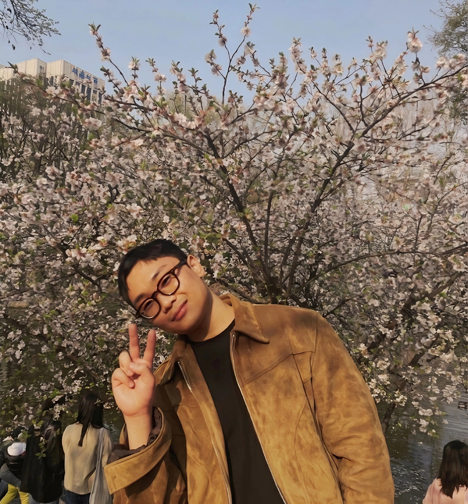

  <!-- Row 1 / Left -->
  

    
  

  <!-- Row 1 / Right -->
  

    
Principal Investigator

    <h1 class="team2-name">Minjeong Yeon, Ph.D.</h1>

    

      
<strong>본인 소개</strong>

      

        MICL에서 연구, 행정, 학생 지도 등 모든 업무에 책임이 있는 연구책임자 연민정 입니다. 2022년 2월 강원대학교 생화학과에서 박사 학위를 받고 4년동안 미국 필라델피아 위스타연구소에서 박사후연구원으로 재직하였습니다. 2026년 3월, 오랫동안 꿈꿔왔던 교수라는 직책을 충북대학교 의과대학 생화학교실에서 맡게 되었습니다.
      

      

        학생들이 중심이되는, 학문적으로 성장할 수 있는 공간이 되는, 연구가 어렵고 힘들지만 함께 웃으며 나아갈 수 있는 그런 연구실을 만들어 나가려고 합니다. MICL에서 진행하는 연구들이 인간의 삶의 질 향상에 도움이 되는 그날까지 함께하는 학생들과 묵묵히, 꾸준히 앞으로 걸어가겠습니다.
      

      

        <strong>취미</strong> : 운동 (Running, Crossfit, etc....) 
        <strong>특기</strong> : 의욕넘쳐 일 만들고 고생하기 
        <strong>좌우명</strong> : 놀땐 놀고, 할땐 하자. 후회없는 과거를 만들자.
      

    

  

  <!-- Row 2 / Left -->
  
Experiences

  <!-- Row 2 / Right -->
  

  <ul class="team2-list">
    <li class="team2-item">
      
Assistant professor

      
2026.03-Current Chungbuk National University, Korea 

    </li>

    <li class="team2-item">
      
Postdoc

      
2022.03–2026.02 The Wistar Institute, U.S. 

    </li>
  </ul>

  <!-- Row 3 / Left -->
  
Education

  <!-- Row 3 / Right -->
  

    <ul class="team2-list">
      <li class="team2-item">
        
Ph.D. in Biochemistry

        
2016.09–2022.02 Kangwon National University, Korea

      </li>
      
      <li class="team2-item">
        
B.S. in Biochemistry

        
2012.03–2016.08 Kangwon National University, Korea

      </li>
    </ul>
  

<!-- Copy this whole 
 ... 
 block to add more people -->

  <!-- Row 1 / Left -->
  

    
  

  <!-- Row 1 / Right -->
  

    
Graduate Student

    <h1 class="team2-name">Beomseop Shin, B.S.</h1>

    

      
<strong>본인 소개</strong>

      

        학부에서 수학교육을 전공했습니다. 직접 실험하고 데이터를 분석해 보고 싶어서 입학하게 되었습니다.
      

      

        <strong>취미</strong> : 운동, 음악 감상
      

    

  

  <!-- Row 3 / Left -->
  
Education

  <!-- Row 3 / Right -->
  

    <ul class="team2-list">
      <li class="team2-item">
        
M.S.-Ph.D. in Medicine

        
2027.03– Chungbuk National University, Korea

      </li>

      <li class="team2-item">
        
B.S. in Mathematics Education

        
–2025.08 Catholic Kwandong University, Korea

      </li>
    </ul>
  

